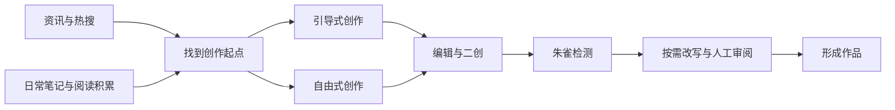
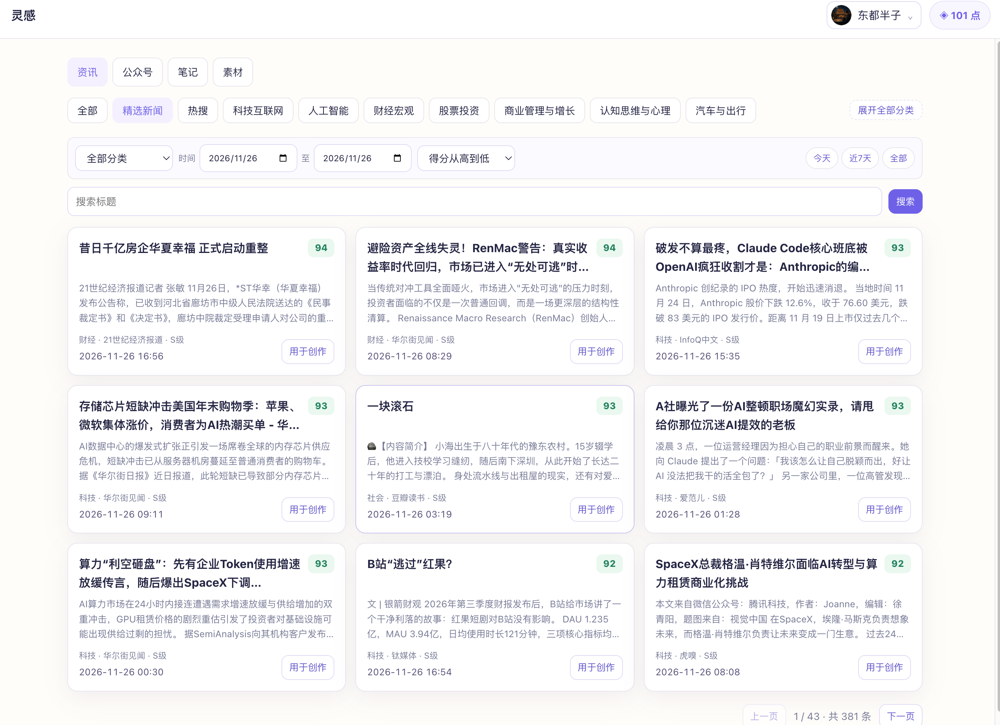
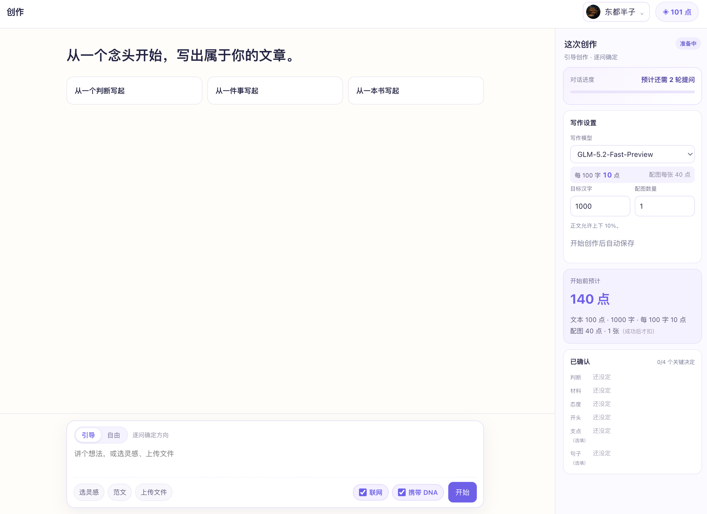
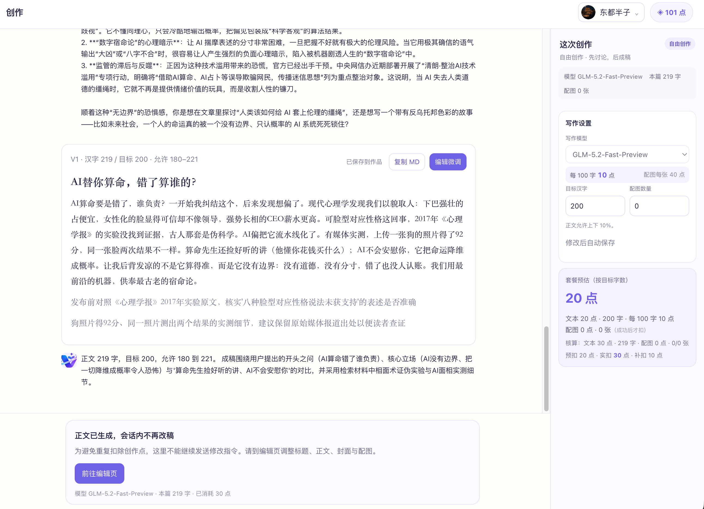
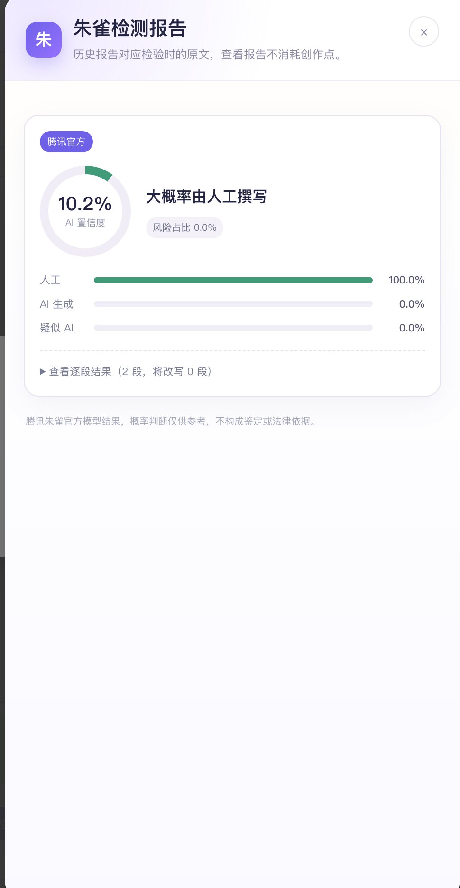

# 微知 Vline · 公众号文章创作、AI 写作与朱雀 AI 检测平台

**公众号文章 · AI 写作 · 内容创作 · 灵感笔记 · 引导式创作 · 自由式创作 · 朱雀 AI 检测 · 一键改写**

你负责想法和判断，让微知陪你把零散的灵感，变成值得分享的内容。

### [立即体验微知 →](https://vline.yunshenai.com/)

微知是一站式 **AI 写作与内容创作平台**，面向**微信公众号文章创作、自媒体写作、文章编辑与二创**等场景，将资讯热搜、灵感笔记、引导式创作、自由式创作、**朱雀 AI 检测（AIGC 检测）**与文章改写连接起来。

适合公众号作者、自媒体创作者，以及希望把阅读与日常思考写出来的每一个人。

---

## 不是缺少想法，而是想法还没变成作品

刷到一条新闻，觉得有话想说；读到一段文字，突然有了感触；随手记下一个观点，却迟迟没有写成文章。

微知把**找灵感、存素材、理思路、写文章、改表达**连接起来，让创作从日常积累自然发生。你可以带着一个模糊的念头开始，也可以直接带着完整想法动笔。

> 今天随手记下的几句话，可能就是明天一篇文章的起点。

## 你可以用微知做什么？

- **公众号文章创作**：从热点资讯、读书笔记或个人观点开始，梳理思路、起草文章，再编辑打磨。
- **AI 辅助写作**：选择引导式创作或自由式创作，把零散灵感逐步展开为完整内容。
- **自媒体内容创作与文章二创**：结合已有素材和自己的理解，调整文章结构、补充观点、改进表达。
- **AI 检测与朱雀检测**：查看文章的 AI 生成倾向和疑似段落，为发布前的人工审阅提供参考。
- **文章改写与表达优化**：按需一键改写，减少套话与生硬表达，让文字更贴近自己的表达习惯。

公众号绑定与一键同步公众号草稿箱属于后续更新计划，详见下方说明。

## 从灵感到作品，走通一条创作路径

### 01 · 不知道写什么？先来发现灵感

从资讯和热搜中观察正在发生的事，寻找与你的兴趣、经验和表达方向相关的切入点。不只是看热点，更是把“这件事很有意思”变成“我想围绕它写点什么”。

*按领域浏览资讯、筛选时间，看到有感触的内容即可点击「用于创作」。*

### 02 · 日常随手记，需要时拿来创作

把转瞬即逝的想法、阅读感悟、观察和经历记成笔记，让素材留得住。想写文章时，再把这些积累带入创作，用自己的经历和观点丰富表达。

**记录不再是终点，而是下一次创作的起点。**

### 03 · 引导式创作：有想法，还没想清楚，也能开始

不必一开始就交出完整提示词或成熟大纲。跟随引导逐步梳理想表达的内容，明确方向、组织思路，再推进成文。尤其适合“有感触，但不知道怎么展开”的时候。

*从一个判断、一件事或一本书写起，通过逐问确认，逐步明确表达方向。*

### 04 · 自由式创作：思路已经有了，就直接写

当你已经知道要说什么，可以直接进入自由式创作，把观点和素材带进来，起草正文、补充内容、调整表达，按自己的节奏推进。需要引导时有人搭把手，想自己掌控时也有足够空间。

*围绕自己的想法自由讨论，生成正文后，可复制 Markdown 或进入编辑页继续微调。*

### 05 · 编辑、二创和一键改写，让初稿更接近你的表达

初稿只是开始。继续编辑、围绕已有素材进行二次创作，或按需发起改写，把文章打磨得更清楚、更自然。素材的使用应尊重原作者与版权，二创也需要自己的判断和表达。

### 06 · 公众号文章发布前，用朱雀 AI 检测看看 AI 痕迹

公众号文章、自媒体稿件或其他创作文本，在发布前可发起**朱雀 AI 检测（AIGC 检测）**，查看文本的 AI 生成倾向与疑似段落，再按需改写、审阅和重新检测，帮助你识别套话与生硬表达。

> 检测结果用于辅助判断，不等于文章中“AI 成分”的客观占比，也不能保证改写后通过任何检测。具体可用能力、计费和检测方式以平台页面为准；如页面提示使用估算结果，应与朱雀官方结果区分。

*朱雀检测报告示例：查看 AI 置信度、人工 / AI 生成 / 疑似 AI 分类及逐段结果。图中数值仅对应这一次检测，不代表其他文章的结果或改写效果承诺。*

## 灵感从哪里来？数据源持续扩充中

微知围绕**资讯、平台热搜、行业内容与海外动态**汇集创作线索。以下为项目数据源配置中的代表性来源，便于了解覆盖方向：

| 类别 | 代表来源 | 可以寻找的灵感 |
| --- | --- | --- |
| 综合资讯与公共议题 | 新华网、人民网、央视网、中国新闻网、澎湃新闻、凤凰网 | 社会事件、公共话题、日常观察 |
| 热搜与社区讨论 | 百度热搜、微博、知乎、今日头条、抖音、Bilibili、贴吧 | 热点话题、用户关注点、不同观点 |
| 财经与商业 | 财联社、华尔街见闻、第一财经、界面新闻、雅虎财经 | 商业变化、行业趋势、财经解读 |
| 科技与数字生活 | 36氪、虎嗅、IT之家、少数派、掘金 | 科技动态、产品观察、数字生活 |
| 海外资讯与开发者社区 | BBC、路透社、美联社、TechCrunch、Hacker News、GitHub Trending | 国际视角、技术趋势、开发者话题 |
| 科研与知识 | Nature、ScienceDaily、NASA、果壳等 | 科学发现、知识科普、跨领域思考 |
| 阅读与兴趣榜单 | 微信读书飙升榜等 | 阅读选题、兴趣内容、长期积累 |

**数据源会持续扩充，覆盖更多领域与创作场景。** 上表是配置覆盖摘要，不代表所有来源当前均已启用或始终可访问；实际展示、更新频率和可用性以平台为准。来源名称仅用于说明内容来源，不代表合作或授权背书。

## 接下来，让创作流程更省心

我们希望把更多重复操作交给平台，让你把注意力留给想法、判断与表达。以下是**后续更新方向，并非全部已经上线**，具体时间和开放范围以平台公告为准。

| 更新方向 | 希望带来的体验 |
| --- | --- |
| 自动选题提炼 | 从资讯、热搜与素材中提炼选题和可展开的观点方向，减少对着空白页面苦想的时间；你只需挑选、判断和补充 |
| 公众号绑定 | 连接自己的公众号，让创作与后续发布准备衔接起来 |
| 一键同步公众号草稿箱 | 完成编辑后将内容同步至草稿箱，方便预览与最后确认 |
| 自动作图与文章配图 | 根据内容生成配图，逐步打通文字与图片的创作流程 |
| 更完整的创作协同 | 持续串联编辑、二创、改写、生图与发布准备，让流程更顺畅 |

> **你只需要想，编辑、二创、生图这些工作，让平台来帮你完成。**
>
> 这是微知持续建设的方向。作品最终表达什么、采用什么内容，由你决定。

## 用一个想法，开始第一次创作

1. **打开微知**：[https://vline.yunshenai.com/](https://vline.yunshenai.com/)。
2. **找一个起点**：看看资讯与热搜，或记下一条今天的想法。
3. **选择创作方式**：需要梳理就用引导式创作，有思路就进入自由式创作。
4. **把文章打磨好**：编辑、检测、按需改写，确认内容与事实后再分享。

如果微知对你有帮助，欢迎给这个仓库一个 **Star**，也欢迎通过 **Issues** 分享使用感受、想接入的数据源和期待的新功能。反馈时请勿提交手机号、登录凭证或私人文章内容。

---

**从一次闪念，到一篇作品。**

**[来微知，让想法开始生长 →](https://vline.yunshenai.com/)**

> 本仓库用于微知平台的产品介绍与体验引导；在线功能以实际页面为准。
